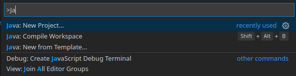
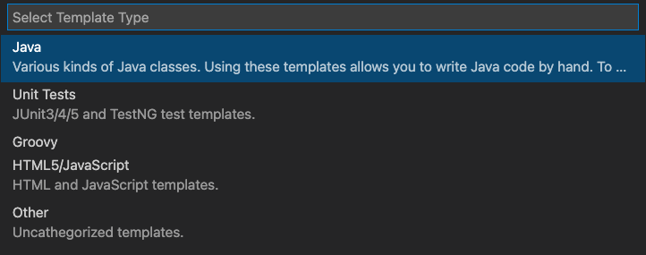
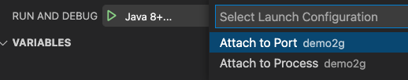
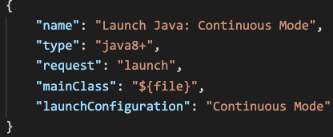

## 21.2.0.1
(2021-08-04)

This is a hotfix release for the GraalVM 21.2.x branch.
It contains some operational fixes as:

* Fixed a `StringBuilder` optimization issue in Java 11-based GraalVM to improve special characters parsing (see [#3627](https://github.com/oracle/graal/issues/3627)). (Only available in GraalVM Enterprise.)
* Fixed issue with `strspn` used in the `date` C extension compiled as a macro on older `glibc` and then missing the `__strspn_c1` symbol on newer `glibc` (see [#2406](https://github.com/oracle/truffleruby/issues/2406)).

## 21.2.0
(2021-07-20)

* [Java and Compiler Updates](#java-and-compiler-updates)
* [Platform Updates](#platform-updates)
* [Native Image](#native-image)
* [Polyglot Runtime](#polyglot-runtime)
* [Java on Truffle](#java-on-truffle)
* [JavaScript](#javascript)
* [WebAssembly](#webassembly)
* [LLVM Runtime](#llvm-runtime)
* [Ruby](#ruby)
* [Python](#python)
* [R](#r)
* [Tools](#tools)
* [Polyglot Embedding](#polyglot-embedding)
* [Truffle Language and Tool Implementations](#trufflelanguage-and-toolimplementations)

### Java and Compiler Updates

* The OpenJDK release that GraalVM Community Edition is built on was updated to:
  * 8u302 for Java 8 based GraalVM Community. See [OpenJDK 8u302 Updates](https://wiki.openjdk.java.net/display/jdk8u/Main "OpenJDK 8u302 Updates")
  * 11.0.12 for Java 11-based GraalVM Community. See [OpenJDK 11.0.12 Updates](https://wiki.openjdk.java.net/display/JDKUpdates/JDK11u "OpenJDK 11.0.12 Updates")
  * 16.0.2 for Java 16-based GraalVM Community. See [OpenJDK 16.0.2 Updates](https://jdk.java.net/16/ "OpenJDK 16.0.2 Updates")

* The Oracle JDK release that GraalVM Enterprise Edition is built on was updated to:
  * 8u301 for Java 8-based GraalVM Enterprise. See [Java SE 8 release notes](https://www.oracle.com/java/technologies/javase/8u301-relnotes.html "Java SE 8 Release Notes")
  * 11.0.12 for Java 11-based GraalVM Enterprise. See [Java SE 11 release notes](https://www.oracle.com/java/technologies/javase/11-0-12-relnotes.html "Java SE 11 Release Notes")
  * 16.0.2 for Java 16-based GraalVM Enterprise. See [Java SE 16 release notes](https://www.oracle.com/java/technologies/javase/16-0-2-relnotes.html "Java SE 16 Release Notes")

* Improved loop limit analysis for counted loops. The compiler will now detect and refine the range of an induction variable by taking the preceding conditions into account. When the loop is counted, it becomes amendable for advanced optimizations like partial unrolling, inversion, and vectorization. Read more [here](https://medium.com/graalvm/graalvm-21-2-ee2cce3b57aa). (Only available in GraalVM Enterprise.)
* Added a novel SIMD (Single Instruction Multiple Data) vectorization optimization for sequential code. This optimization is disabled by default until the 21.3 release. Enable it with `-Dgraal.VectorizeSIMD=true`. (Only available in GraalVM Enterprise.)
* Added a novel Strip Mining optimization for non-counted loops. Strip mining is disabled per default. Enable it with the `-Dgraal.StripMineNonCountedLoops=true` option. (Only available in GraalVM Enterprise.)
* The existing `StringBuilderOptimizationPhase` performs high level transformations on `StringBuilder` patterns to directly construct the final `String` and eliminate unnecessary intermediate `Strings` and `StringBuilders`. This release adds support for this optimization in JDK11 by adding support for the compact `String` representation used in the JDK. The core optimizations were improved to handle more code shapes and to constant fold more operations. (Only available in GraalVM Enterprise.)
* Improved safepoint elimination in long counted loops. The compiler can now eliminate safepoints in loops that have a `long` induction variable (as opposed to an `int`) where it can statically prove that the range of the induction variable (i.e., the maximum number of iterations) is `Integer.MAX_VALUE - Integer.MIN_VALUE` while previously it would only consider `int`-typed induction variables. Read more [here](https://medium.com/graalvm/graalvm-21-2-ee2cce3b57aa). (Only available in GraalVM Enterprise.)
* Added an optimization that tries to move writes out of loops, called "Write Sinking." Write Sinking is an experimental feature disabled by default. Enable it with `-Dgraal.OptWriteMotion=true`. (Only available in GraalVM Enterprise.)
* Implemented a Speculative Guard Movement optimization that tries to move a loop invariant guard (e.g., an array bounds check) inside a loop to outside the loop. This change improves the geomean throughput score of GraalVM Community on SpecJVM2008 by 4.2%. The scores on the Renaissance, DaCapo, and ScalaDacapo benchmarks also increased by about 0.5%. Disable it with `-Dgraal.SpeculativeGuardMovement=false`.
* Added intrinsic for `Reference.refersTo` and `PhantomReference.refersTo` just like it was [done for C2](https://bugs.openjdk.java.net/browse/JDK-8256999).
* Added support for applying counted loop optimizations to `do`/`while` loops whose first iteration is not guarded by the loop condition.
* Added guard hoisting loop duplication phase which should contribute to ahead-of-time compilation flow (GraalVM Native Image). It splits certain loops into "fast" and "slow" versions. The fast loop is chosen if we know at run time that no exceptions can happen. The fast loop allows more loop optimizations and loop vectorization. Loop duplication needs the profile-guided optimizations data. Disable it with `-H:-GuardHoistingLoopDuplication`.
* Improved the Graal compiler to allow compiling ahead-of-time methods with more than 64 loops. This resolves a problem that was preventing [Native Image](/reference-manual/native-image/) from compiling programs with more than 64 loops in a method body. This is a pattern often seen in generated Java code, such as that output by tools such as ANTLR.

### Platform Updates

* Linux AArch64: GraalVM distributions for AArch64 CPU architecture are released as supported in 21.2 with more features enabled, like Ruby runtime, and Java on Truffle (Espresso).
* Java 16 support: GraalVM builds based on Oracle JDK 16 or OpenJDK 16 remain experimental in this release, but have become more "mature" by overcoming some known limitations and adding support for Ruby, Python, and WebAssembly runtimes.

### Native Image

* Released new official Gradle and Maven plugins for Native Image with initial [JUnit 5](https://junit.org/junit5/) testing support. These plugins will make building, testing, and running Java applications as native executables much easier, and the native JUnit support allows JVM libraries to run their test suites via GraalVM Native Image. For more details, read the [announcement blog post](https://medium.com/graalvm/gradle-and-maven-plugins-for-native-image-with-initial-junit-testing-support-dde00a8caf0b).
* Added basic Java Flight Recorder (JFR) support on JDK 11. This feature was developed in a cooperation between Oracle and Red Hat. Native images that are built with `-H:+AllowVMInspection` support JFR events that are written in Java (see [`jdk.jfr.Event`](https://docs.oracle.com/en/java/javase/11/docs/api/jdk.jfr/jdk/jfr/Event.html)). To record JFR events at run time, JFR support and JFR recording must be enabled. Check the [documentation](../../docs/reference-manual/native-image/guides/build-and-run-native-executable-with-jfr.md) or see the help message for `-XX:+FlightRecorder` and `-XX:StartFlightRecording` options. At the moment, JFR support is still significantly limited, i.e., most VM-internal events and also most advanced features such as stack traces or memory leak detection are still missing.
* Improved resource handling: resources stored in the image can be accessed through a virtual file system.
* Implemented the class pre-definition: to support `ClassLoader.loadClass` at run time, classes that need to be loaded at run time can be made available to the static analysis so that they are included in the closed-world analysis. This improves compatibility with libraries that rely on dynamic class loading, as long as the classes loaded or generated at run time are stable. This feature was developed in cooperation with Oracle and Alibaba.
* Removed unnecessary security providers from the image: the reachable security providers are automatically detected by the static analysis. We fixed some bugs that made too many providers reachable in some cases, leading to large and non-deterministic image sizes. It is now also possible to disable the automatic detection completely using `-H:-EnableSecurityServicesFeature`.
* Added an "epsilon" GC to build an image without any garbage collector, which is applicable for very short running applications that only allocate a small amount of memory.  The application fails when more than the maximum heap size is allocated. Enable it at image build time with `--gc=epsilon`.
* Changed the `--initialize-at-build-time` option behaviour to be used only with arguments. This prevents users to write non-composable code and to avoid accidental semantic errors.

### Polyglot Runtime

* Added a new compilation queuing heuristic enabled by default. The new heuristic improves the warmup time of the polyglot runtime on many workloads. It detects code being currently executed and prioritizes the compilation of such code. The new queue implementation also uses dynamic compilation thresholds that increase and decrease compilation thresholds depending on the load of the compilation queue. The new heuristic can be enabled or disabled using `--engine.TraversingCompilationQueue=true|false`. A more detailed description of the new heuristic can be found [here](https://github.com/oracle/graal/blob/master/truffle/docs/TraversingCompilationQueue.md).
* VM inspection is now enabled in all launchers by default. It is no longer necessary to rebuild the language launcher image to enable inspection. The `SIGQUIT` signal can now be used to print thread dumps at any point during their execution. By additionally enabling the performance counters with the `--vm.XX:+UsePerfData` option in GraalVM Enterprise, VisualVM is able to attach and monitor language launchers that run with `native-image`.

### Java on Truffle

* Introduced Truffle on Java HotSwap Plugin API which allows to reload the code without the need for restarting a running application. It is meant for framework developers to reflect changes to, e.g., annotations, framework-specific updates such as implemented services or beans. For more details, check the [documentation](/reference-manual/java-on-truffle/hotswap/).
* Improved bytecode dispatch, yielding a 15-30% interpreter speed-up.
* Added a new static object model implementation that dynamically generates host classes at run time. It is experimental at the moment.
* Added fixes to prevent crashes when external threads enter Espresso and call native code.
* Fixed crashes when running with older versions of GNU libc (<= 2.17).
* Added support for additional interoperability messages for guest objects implementing `Map`, `Map.Entry`, `List`, `Iterator`, or `Iterable`.

### JavaScript

* GraalVM JavaScript now prints a warning when runtime compilation is not supported. This warning can be disabled using the `-engine.WarnInterpreterOnly=false` option or the `-Dpolyglot.engine.WarnInterpreterOnly=false` system property.
* Added the `js.unhandled-rejections` option to track unhandled promise rejections in a polyglot `Context`. By default, the option is set to `none`, and unhandled promise rejections are not tracked.
* Implemented the [New Set Methods proposal](https://github.com/tc39/proposal-set-methods). It is available behind an experimental flag (`--js.new-set-methods`).
* Implemented experimental operator overloading support. Use the experimental option `--js.operator-overloading` to enable it and consult the [documentation](https://github.com/oracle/graaljs/blob/master/docs/user/OperatorOverloading.md).
* Updated the RegExp Match Indices proposal with opt-in using the `d` flag. Available in ECMAScript 2022 (`-js.ecmascript-version=2022`). Deprecated the `-js.regexp-match-indices` option.

The [changelog](https://github.com/oracle/graaljs/blob/master/CHANGELOG.md#version-2120) is available in the project repository.

### WebAssembly

* GraalVM's WebAssembly now correctly detects memory-allocation failures, and throws WebAssembly errors as per specification (`RangeError` exception), instead of returning internal engine errors.
* Fixed edge-cases in calls to functions from imported tables. In indirect calls (`call_indirect` instruction) GraalWasm will now correctly type-check the function type when the function is exported from a different module and set as an entry in an imported table.
* Improved detection of some arithmetic errors, printing out a more specific type of the arithmetic exception. In the earlier version, handling of certain arithmetic errors caused a `NullPointerException`.
* Performed general maintenance work and fixed bugs to pass tests for as many NPM modules that use WebAssembly as possible.

### LLVM Runtime

* Added support for `pthreads` and `pthread` synchronization primitives in managed mode such as`pthread_create`, `pthread_exit`, `pthread_join`, `pthread_mutex`, `pthread_rwlock`, `pthread_cond`, and more. This enables a user to run multi-threaded programs. Previously, it would just fail when a user tried to run a multi-threaded software. (Only available in GraalVM Enterprise.)
* Updated `musl libc` to version 1.2.2. (Only available in GraalVM Enterprise.)
* Added support for C++ virtual calls via cross-language interoperability.
* Added support for atomic versions of already existing assembly instructions. This means that the LLVM runtime now has wider support for inline assembly, especially for multi-threaded software.
* Fixed GraalVM's LLVM toolchain not working correctly for C++ on MacOS 11.3 (see [#3383](https://github.com/oracle/graal/issues/3383).

The project changelog is available [on GitHub](https://github.com/oracle/graal/blob/master/sulong/CHANGELOG.md#version-2120).

### Ruby

* Implemented the precise invalidation for Ruby methods and constants, by using per-name and per-class assumptions.
* Updated to Ruby 2.7.3 (fixes CVE-2021-28965 and CVE-2021-28966). The `resolv` stdlib was not updated (`resolv` in 2.7.3 has [bugs](https://bugs.ruby-lang.org/issues/17748)).
* Fixed the LLVM toolchain issue on macOS 10.13 (see  [#3383](https://github.com/oracle/graal/issues/3383)).
* Improved the `#dig` method to make iteration through arrays and hashes faster and compile better for calls with 3+ arguments (see [#2301](https://github.com/oracle/truffleruby/pull/2301)).
* Improved fiber-local variables by using less synchronization which made them faster.
* [`TruffleSafepoint`](https://www.graalvm.org/truffle/javadoc/com/oracle/truffle/api/TruffleSafepoint.html) is now used instead of custom logic, which no longer invalidates JIT-ed code for guest safepoints (e.g., `Thread#{backtrace,raise,kill}`, `ObjectSpace`, etc.).

A full list of changes is available in the [changelog](https://github.com/oracle/truffleruby/blob/master/CHANGELOG.md#2120).

### Python

* Implemented `_pickle` as a faster version than the pure Python version. Users will see better performance when serializing objects across the network. (Only available in GraalVM Enterprise.)
* Improved Python performance especially during warmup and in shared engine configurations by adding fast paths, intrinsifying functions, and adding optimized representations for common data structures.
* Applied the new [Truffle safepoint mechanism](https://www.graalvm.org/truffle/javadoc/com/oracle/truffle/api/TruffleSafepoint.html) for more efficient GIL releases, signal handlers, and weak reference callbacks.
* Updated the supported HPy version to 0.0.2.
* Added support for the `dict` type properly using the new hash interoperability messages. Now Python dictionaries can be cast to `java.util.Map` and behave as expected when using Python from Java.
* GraalVM Python runtime now passes more compatibility tests for `io`, `crypt`, and more functions in `socket`, `OrderedDict`, and `time`. The code written for Python 3.8 that uses these can be expected to work better now.
* Added initial support for the `psutil` package which enables system access and processes monitoring, and for the `PyGame` modules designed for writing video games.
* GraalVM's Python no longer unconditionally creates `_pycache_` if the file name "sitecustomize.py" exists in the current working directory.

More details can be found in the [changelog](https://github.com/oracle/graalpython/blob/master/CHANGELOG.md#python-changelog).

### R

* Continued improving the compatibility with R 4.0.3. For example, the support for `rlang` 0.4.10, `vctrs` 3.6, `tibble` 3.0.6, and `testthat` 3.0.1  packages was significantly improved.
* Packages with known issues, `dplyr` 1.0.3, `ggplot` 3.3.3, and `knitr` 1.31, still remain.

More details are available in the project [changelog](https://github.com/oracle/fastr/blob/master/CHANGELOG.md#2120).

### Tools

#### Visual Studio Code
* Renamed extensions for VS Code as following:
  * GraalVM Tools for Java
  * GraalVM Extension Pack for Java
  * GraalVM Tools for Micronaut

##### GraalVM Tools for Java Extension
* Implemented full support of JDK16 and its language features.
* Added support for developing, running, and debugging single Java class, supported from JDK8 and beyond.
* Introduced a wizard to easily create a new Java project:

* Introduced a new class wizard "Java: New From Template" that allows to add various Java and related files to a project:

* Implemented the possibility to attach a debugger to a running process. Available via Run and Debug "Java 8+..." configuration.

* Improved Java code navigation with "GoTo Type", "Find Usages" options.
* Enabled the Native Image agent to gather the configuration data in the "Run without Debugger" mode. This makes it easier to build native images from VS Code. Use a special launch configuration **Launch Java 8+ Application With Native Image Agent**.

##### GraalVM Tools for Micronaut Extension
* Added  "Launch Java: Continuous Mode" launch configuration also known as "Run Dev Mode" for Gradle and Maven projects:

* Developed and ran Spock tests in the Groovy language. Included code completion and other editing support for Groovy.

#### VisualVM and VS Code Integration
* Added a special section to the VS Code **Gr** activity to control the VisualVM tool included in the active GraalVM installation. The major updates are:
  * Enabled to start VisualVM along with the VS Code project
  * Provided actions to take a thread or heap dump, and to configure and control CPU/Memory sampling and JFR recording
  * Enabled the Go to Source action in VisualVM views which opens the sources back in VS Code

#### VisualVM
* Added a feature that allows to save JFR recording from live process (see [#297](https://github.com/oracle/visualvm/issues/297)).
* Implemented a lock contentions profiling feature, by adding a Lock Contention view in the Profiler tab (see [#298](https://github.com/oracle/visualvm/issues/298)).
* Added support for JDK 17.
* Enabled controlling VisualVM instance from the command line or an external tool: start sampling ([#321](https://github.com/oracle/visualvm/issues/321)), control flight recording ([#322](https://github.com/oracle/visualvm/issues/322)), taking a thread ([#319](https://github.com/oracle/visualvm/issues/319)) or a heap dump ([#320](https://github.com/oracle/visualvm/issues/320)) of a Java process from the terminal.
* Published Maven artifacts for VisualVM.

### Polyglot Embedding 

As announced in the [21.1 release notes](21_0.md), we have updated the required JVMCI version for Polyglot Embeddings in this release. All GraalVM JDK versions (8, 11, 16) already contain the updated JVMCI version and there is no further action required. If you are using a different JDK than GraalVM and you have configured the Graal compiler on the upgrade module path you will need one of the following JDK versions that includes [JDK-8264016](https://bugs.openjdk.java.net/browse/JDK-8264016) for full compatibility:

  * Other JDK 11: Oracle JDK 11.0.13 (2021-10-19), OpenJDK is still to be determined.
  * Other JDK 16: No current plans to update JVMCI.
  * Other JDK 17: The new JVMCI version is already integrated into early access builds.

If your JVMCI version is outdated, you will be able to use GraalVM embeddings, but forced context cancellation (`Context.close(true)`) and interrupt (`Context.interrupt(Duration)`) will throw an error. We recommend the following workarounds:

  * Do not use forced context cancellation or interrupt. All other features are still supported.
  * Switch to the fallback runtime by removing graal.jar from the upgrade-module-path. Note that this will significantly worsen performance and should only be a last resort.
  * Wait with upgrading to 21.2 until the JDK version has support for the new JVMCI version.

Other changes:
* Changed the behaviour of `Value.as(TypeLiteral<Function<Object, Object>>).apply()`: when the function is called with an `Object[]` argument, it is passed through as a single argument rather than an array of arguments (see [#456](https://github.com/oracle/graaljs/issues/456)).

A full list of changes can be found [here](https://github.com/oracle/graal/blob/master/sdk/CHANGELOG.md#version-2120).

### Truffle Language and Tool Implementations

* Added support for Truffle libraries to be prepared for ahead-of-time compilation without prior execution. See [ExportLibrary.useForAOT](https://www.graalvm.org/truffle/javadoc/com/oracle/truffle/api/library/ExportLibrary.html#useForAOT--) or the [AOT Tutorial](../../truffle/docs/AOT.md#truffle-aot-tutorial) for more details.
* Implemented `DebugValue` methods `hashCode()` and `equals()` to provide results of the interoperability `identityHashCode` and isIdentical calls on the corresponding guest objects, respectively.
* Added support for iterators and hash maps to `DebugValue`. The added methods delegate to the respective methods of `InteropLibrary`.
* Methods annotated with `@Fallback` of the Truffle specialization DSL now support `@Cached`, `@CachedContext`, `@CachedLanguage`, `@Bind` and dispatched `@CachedLibrary` parameters.
* Added `TruffleContext.pause()` and `TruffleContext.resume(Future<Void>)` to pause and resume execution for a Truffle context, respectively.
* Added `CompilerDirectives.blackhole(value)` which can be helpful for benchmarking.
* Added `TruffleLanguage#Env.registerOnDispose(Closeable)` registering a `Closeable` for automatic close on context dispose.
* Added `RootNode#countsTowardsStackTraceLimit()`, replacing `RootNode#isInternal()` as the criterion that determines whether a frame with the given root node counts towards the stack trace limit.
* Added `MemoryFence` which provides methods for fine-grained control of memory ordering (see [#2031](https://github.com/oracle/graal/pull/2031)).
* Deprecated `ValueProfile.createEqualityProfile()` without replacement. `Object.equals(Object)` cannot safely be used on compiled code paths. Use the Truffle Specialization DSL instead to implement caches with equality semantics. Making `Object.equals(Object)` reachable as runtime compiled method will mark too many equals implementations reachable for runtime compilation in a native image.
* Deprecated and added methods to support expected arity ranges in `ArityException` instances. Note that the replacement methods now include more strict validations.
* The Specialization DSL now generates code to throw an `AssertionError` if a `@Shared` and `@Cached` parameter returns a non-null value and is used in a guard. The null state is reserved for the uninitialized state.
* Added `LoopConditionProfile#create()` as an alias of `createCountingProfile()` so it can be used like `@Cached LoopConditionProfile loopProfile`.

A full list of changes can be found [here](https://github.com/oracle/graal/blob/master/truffle/CHANGELOG.md#version-2120).
