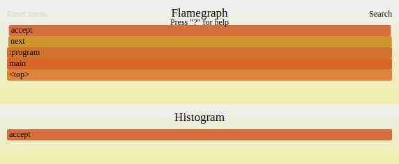
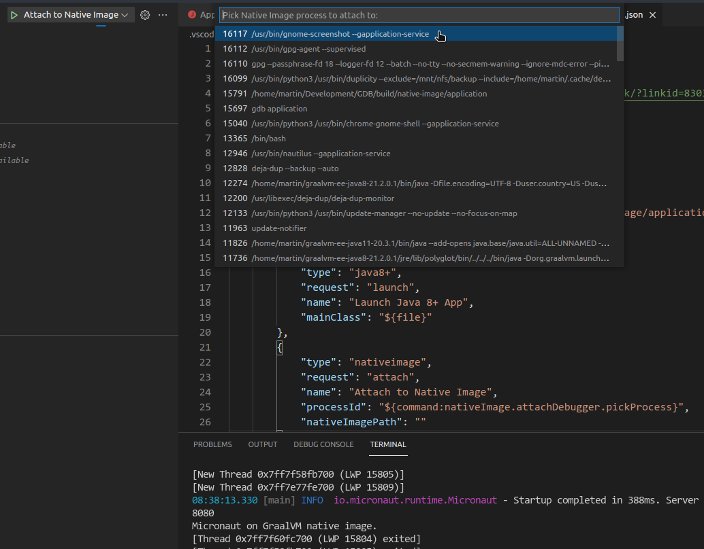
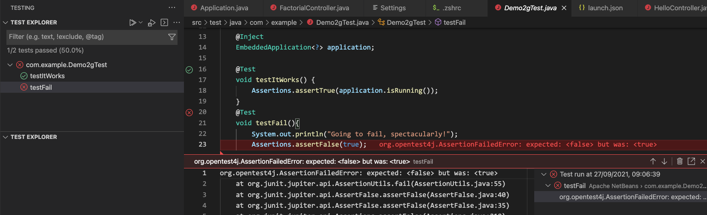
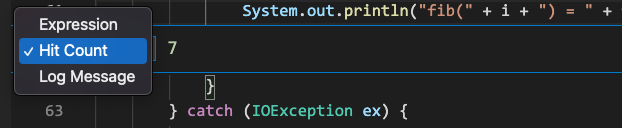
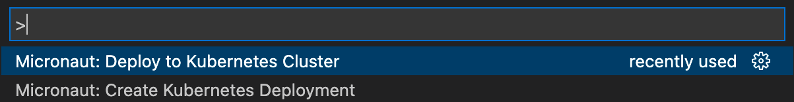
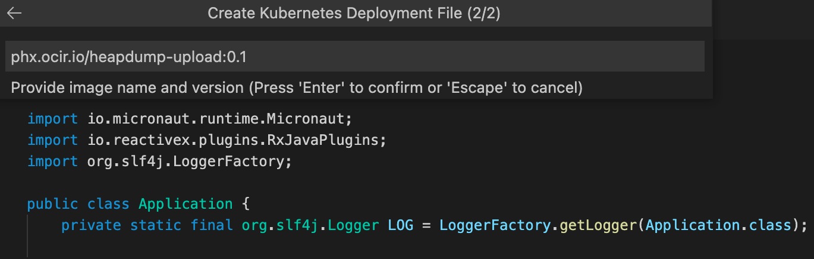
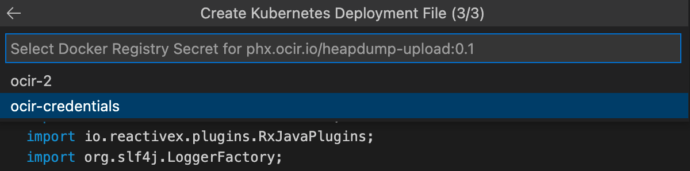

## 21.3.3.1
(2022-09-20)

This is a patch release for the GraalVM 21.3.3 branch which includes the following:

* Platform updates:
  * **11.0.16.1** for Java 11-based GraalVM
  * **17.0.4.1** for Java 17-based GraalVM

* Prevent the Truffle file system sandbox from checking host files while parsing paths using alternative file system providers.
* The `hashCode()` and `equals(`) methods of `InsightFilter` are corrected and context management is fixed.
* Corrected the depth in insight heap dumps: it does not apply to primitives and is applied to variables, not the frame.
* Fixed the `PolyglotFunction` to not treat null argument as zero arguments.

## 21.3.3
(2022-07-26)

This is July 2022 Critical Patch Update (CPU) for GraalVM Community Edition.
It is a full distribution and supersedes the previous release of GraalVM Community Edition 21.3.x.
It is based on OpenJDK CPU and includes all the OpenJDK security fixes released as part of that CPU, and platform updates.

* Updated the OpenJDK release on which GraalVM Community Edition is built to:
  * **11.0.16** for Java 11-based GraalVM Community. See [OpenJDK 11.0.16 Updates](https://wiki.openjdk.java.net/display/JDKUpdates/JDK11u "OpenJDK 11.0.16 Updates")
  * **17.0.4** for Java 17-based GraalVM Community. See [OpenJDK 17 Updates](https://jdk.java.net/17/ "OpenJDK 17 Updates")

## 21.3.2
(2022-04-26)

This is April 2022 Critical Patch Update (CPU) for GraalVM Community Edition.
It is a full distribution and supersedes the previous release of GraalVM Community Edition 21.3.x.
It is based on OpenJDK CPU and includes all the OpenJDK security fixes released as part of that CPU, and platform updates.

* Updated the OpenJDK release on which GraalVM Community Edition is built to:
  * **11.0.15** for Java 11-based GraalVM Community. See [OpenJDK 11.0.15 Updates](https://wiki.openjdk.java.net/display/JDKUpdates/JDK11u "OpenJDK 11.0.15 Updates")
  * **17.0.3** for Java 17-based GraalVM Community. See [OpenJDK 17 Updates](https://jdk.java.net/17/ "OpenJDK 17 Updates")

## 21.3.1
(2022-01-18)

This is January 2022 Critical Patch Update (CPU) for GraalVM Community Edition.
It is a full distribution and supersedes the previous release of GraalVM Community Edition 21.3.x.
It is based on OpenJDK CPU and includes all the OpenJDK security fixes released as part of that CPU, and platform updates.

* The OpenJDK release that GraalVM Community Edition is built on was updated to:
  * **11.0.14** for Java 11-based GraalVM Community. See [OpenJDK 11.0.14 Updates](https://wiki.openjdk.java.net/display/JDKUpdates/JDK11u "OpenJDK 11.0.14 Updates")
  * **17.0.2** for Java 17-based GraalVM Community. See [OpenJDK 17 Updates](https://jdk.java.net/17/ "OpenJDK 17 Updates")
* Removed support for JDK versions 12, 13, 14, 15, and 16.
* Updated Node.js to version 14.18.1.

## 21.3.0
(2021-10-19)

* [Java and Compiler Updates](#java-and-compiler-updates)
* [Platform Updates](#platform-updates)
* [Native Image](#native-image)
* [Polyglot Runtime](#polyglot-runtime)
* [Java on Truffle](#java-on-truffle)
* [JavaScript](#javascript)
* [Ruby](#ruby)
* [Python](#python)
* [R](#r)
* [LLVM Runtime](#llvm-runtime)
* [WebAssembly](#webassembly)
* [Tools](#tools)
* [Polyglot Embedding](#polyglot-embedding)
* [Truffle Language and Tool Implementations](#trufflelanguage-and-toolimplementations)

### Platform Updates

* Java 17 support: The GraalVM distributions based on Oracle Java 17 and OpenJDK 17 are [available for download](https://www.graalvm.org/downloads/).
* As of this release and further, there will be GraalVM Community distributions based on OpenJDK 11 and 17 only (no distributions based on OpenJDK 8).
* The 21.3 release line will be the last one to contain GraalVM Enterprise based on Oracle JDK 8. 22.x and further will only contain distributions based on Oracle Java 11 and 17.

* The OpenJDK release that GraalVM Community Edition is built on was updated to:
  * **11.0.13** for Java 11-based GraalVM Community. See [OpenJDK 11.0.13 Updates](https://wiki.openjdk.java.net/display/JDKUpdates/JDK11u "OpenJDK 11.0.13 Updates")
  * **17.0.1** for Java 17-based GraalVM Community. See [OpenJDK 17 Updates](https://jdk.java.net/17/ "OpenJDK 17 Updates")

* The Oracle JDK release that GraalVM Enterprise Edition is built on was updated to:
  * **8u311** for Java 8-based GraalVM Enterprise. See [Java SE 8 release notes](https://www.oracle.com/java/technologies/javase/8u311-relnotes.html "Java SE 8 Release Notes")
  * **11.0.13** for Java 11-based GraalVM Enterprise. See [Java SE 11 release notes](https://www.oracle.com/java/technologies/javase/11-0-13-relnotes.html "Java SE 11 Release Notes")
  * **17.0.1** for Java 17-based GraalVM Enterprise. See [Java SE 17 release notes](https://www.oracle.com/java/technologies/javase/17-relnotes.html "Java SE 17 Release Notes")

### Java and Compiler Updates

* Improved the Strip Mining optimization for non-counted loops (only available in GraalVM Enterprise), which includes:
  * Enabled Strip Mining for non-counted loops by default.
  * Improved counted loop detection for inequality checked loops. Now more uncounted loops are converted to counted loops, becoming subject to further optimization such as vectorization and partial unrolling. This extra optimization adds to better performance. Take this loop as an example:
  ```java
  for (int i = start; i != end; i++){
     // body
  }
  ```
  The compiler cannot statically prove that `start < end` and so this loop may have to overflow `i` before it terminates.
  The compiler now inserts a `start < end` check before the loop.
  If this check fails, the compiled code will deoptimize and the next time it is compiled,
  the check will be omitted and the loop will be treated as uncounted.

* Added a new Infeasible Path Correlation optimization to eliminate infeasible paths (only available in GraalVM Enterprise). Have a look at this snippet:
  ```java
  class A { ... }
  class B extends A { ... }

  if (x > 5) {
      if (y instanceof A) {
          throw Error();
      }
  }
  loop {
      int foo = <expensive computation>;
      if (x > 10) {
          if (y instanceof B) {
              bar(foo);
          }
      }
  }
  ```
  The `bar(foo)` call will only be executed if `x > 10 && y instanceof B`.
  However, that condition implies `x > 5 && y instanceof A` which means `throw Error()` will be executed.
  That is, the call to `bar` can never actually be executed.
  The Graal compiler now recognizes this and eliminates both the call to `bar` as well as the computation of `foo` if it is only used as an argument to `bar`.
  This optimization is enabled by default and can be disabled with `-Dgraal.InfeasiblePathCorrelation=false`.

* Implemented support for Constant Blinding to defend against JIT spraying attacks. In a JIT spraying attack, an attacker uses the JIT compiler to inject machine instructions in executable memory by using operations with immediate values. Given an existing memory corruption vulnerability, the attacker can then redirect control flow to the injected code. (Only available in GraalVM Enterprise.)
The constant blinding phase encrypts user supplied constants in the code with a randomly generated key, so that the attacker cannot rely on the immediate value being present in executable memory:
  ```bash
  mov reg, $0xF5952C
  xor reg, $0xABCDEF // reg = 0x5E58C3
  ```
  Constant Blinding is an experimental feature disabled by default. Enable it with `-Dgraal.BlindConstants=true`.
  Configure with `-Dgraal.MinimumBlindedConstantSize` the size of constants (in bytes) above which constant blinding will be applied.

* Improved the SIMD (Single Instruction Multiple Data) vectorization optimization for sequential code (only available in GraalVM Enterprise):
  * SIMD Vectorization and Partial Loop Unrolling can now be enabled at the same time. It is no longer necessary to specify `-Dgraal.PartialUnroll=false` to maximize the benefit achieved from SIMD Vectorization. This optimization is now enabled by default.
  * SIMD Vectorization can now create groups of operations which do not completely fill a vector register. This increases the number of acceleration opportunities SIMD Vectorization is able to realize and so improves overall throughput performance.
  * Improved grouping and pattern matching in SIMD Vectorization to increase the number of SIMD opportunities the optimization can find and successfully exploit.

* Added a new optimization that prevents inlining from negatively impacting register allocation and code size for certain caller/callee combinations. This can improve performance because fewer values may be existing concurrently in a program. (Only available in GraalVM Enterprise.)

* Added compiler intrinsics for following methods in both JVM and Native Image mode: `Math.signum`, `Math.copySign`, `Reference.refersTo` and `PhantomReference.refersTo`.
The way intrinsics operate is to replace a native method with direct machine code. Thus intrinsification of the above Java methods removes the overhead of native calls, which is considerable and improves the overall performance. For example, intrinsifying `Reference.refersTo` and `PhantomReference.refersTo` fixed the performance regression reported in [this GitHub issue](https://github.com/oracle/graal/issues/3349).

A full list of compiler changes in GraalVM Community Edition can be found in the [compiler changelog](https://github.com/oracle/graal/blob/master/compiler/CHANGELOG.md).

### Native Image

* Improved the Native Image configuration: configuration file entries that are necessary at image build time for Reflection, JNI, class path resources, and Dynamic Proxy objects, can now be conditional based on the reachability of a class. This allows a more precise configuration, which can reduce the size of a native image. See the [documentation](https://www.graalvm.org/jdk21/reference-manual/native-image/dynamic-features/Reflection/#conditional-configuration) and find there an example for a conditional reflection configuration.
* Improved gathering the reflection metadata by the `native-image` builder: Native Image now distinguishes between queried and invoked reflection methods. Calling `Class.getDeclaredMethods` (and all the other variants to look up methods and constructors) now returns all reachable methods for all classes. Previously, only methods that were explicitly registered for reflective invocation were returned. This new feature allows significant reduction of the manual reflection configuration: only methods that need to be invoked via `Method.invoke`, or methods that would not be seen as reachable based on reachability, need to be registered manually. This distinction between queried and invoked reflection methods reduces the filesize of a native image.
* Added several new optimizations to reduce the image size as well as the image build time for large applications. This has been an ongoing effort for several releases. The following table shows the image size and image build time for [Spring petclinic-jdbc](https://github.com/spring-petclinic/spring-petclinic-data-jdbc), a well-known large application. The numbers are measured on a developer laptop with Linux, AMD64, JDK 11, GraalVM Enterprise, spring-native 0.10.3:

  | GraalVM Version | Image Build Time | Image Size |
  |-----------------|------------------|------------|
  | GraalVM 21.1    |  170 sec.        |  138 MByte |
  | GraalVM 21.2    |  163 sec.        |  133 MByte |
  | GraalVM 21.3    |  133 sec.        |  119 MByte |

* Added initial support for the Java Platform Module System: The `native-image` builder now accepts the module-related arguments known from the `java` launcher like `-m`, `-p`, and `--add-opens`. When such a module-related argument is used, the image generator itself is used as a module too. This is a major change in how the image generator works, and development is still ongoing to support more aspects of the module system. Please provide feedback and bug reports when you try out this new feature.
* Changed the way the compiler is looked up when creating static, `musl`-based native images to use the `musl` toolchain from [musl.cc](https://musl.cc/). The `musl` toolchain greatly simplifies the creation of static native images. Using a toolchain also ensures minimum changes will be needed on users' side to create a dynamically linked `musl` based image. See the [documentation](https://www.graalvm.org/reference-manual/native-image/guides/build-static-executables/).
* Added a new policy for the [Serial GC](https://www.graalvm.org/jdk21/reference-manual/native-image/optimizations-and-performance/MemoryManagement/) reducing the memory footprint of applications at run time. The new policy enables survivor spaces for the young generation, a feature that has been present in the codebase for a while but was not enabled by default. In addition, a full GC no longer scans the whole image heap for root pointers, but only parts of the image heap that have been written to. The new policy is not enabled by default (this is planned for the next release) but can be enabled using `-H:InitialCollectionPolicy=Adaptive`. Please test the new policy and report any regressions so that they can be addressed before the next release.
* Improved the precision of the static analysis: small methods are now inlined before the static analysis. This improves constant folding and reduces surprises. For example, previously code that accessed a static final field directly was optimized differently from code that accessed a static final field via an accessor method:
  ```java
  void foo() {
     if (MyConfiguration.WINDOWS) {
       // The static analysis does not see this code as reachable on non-Windows platforms.
    }
  }

  static boolean isWindows() {
    return MyConfiguration.WINDOWS;
  }
  void bar() {
    if (isWindows()) {
      // The static analysis marked this code as reachable because the method invocation prevented constant folding before the static analysis. With method inlining before static analysis enabled now, this code is no longer seen as reachable on non-Windows platforms.
    }
  }
  ```
* Arguments to the native image generator can now be passed in a separate file that is provided with the `@argument` option. This is a necessary workaround for platforms like Windows where the length of the command line is limited.
* Root certificates can now be configured at image run time. Previously, the root certificates present at image build time were the only root certificates available at run time. See the [documentation](https://www.graalvm.org/jdk21/reference-manual/native-image/dynamic-features/CertificateManagement/#runtime-options) for details, and to find a list of system properties that are now read at run time to configure the root certificates.
* Crash dumps, which are printed when segfault or fatal VM errors happen, now include more details to aid diagnostics. Also, the beginning of the image heap is now protected memory so that null pointer accesses produce a segfault instead of accessing random memory. Internal VM errors, where an illegal virtual method table entry is accessed, produce a better crash dump.
* On Linux, the processor count reported at run time now takes limitations set via `cpuset` into account.
* Improved Dwarf debug info generation now includes information about inlined methods (contributed by Red Hat).
* JDK Flight Recorder (JFR) support is now also available for JDK 17 based GraalVM (contributed by Red Hat).

### Polyglot Runtime

* Improved stability and performance of the experimental engine caching feature. See the [documentation](https://www.graalvm.org/jdk21/graalvm-as-a-platform/language-implementation-framework/AuxiliaryEngineCachingEnterprise/) for more details. (Only available in GraalVM Enterprise.)
* Improved builtin CPU sampler tool usability with all polyglot languages (see `--cpusampler` option).
  *  Increased precision of the sampling output by using the new guest language safepoint mechanism. The sampling output now shows inlined methods in addition to compilation units by default.
  *  Simplified the default sampling histogram output and added the `--cpusampler.ShowTiers` option to show time spent in each optimization tier.
  *  Added the SVG flamegraph output format to the CPUSampler. To enable it, use option `--cpusampler.OutputFormat=flamegraph`.

     

### Java on Truffle

* Added Java 17 guest and host support.
* Enabled support using interop buffer-like object as `byte[]` in Java on Truffle. See "buffer elements" in the [Interop API javadoc](https://www.graalvm.org/truffle/javadoc/com/oracle/truffle/api/interop/InteropLibrary.html).
* Added support for buffer interop messages to the explicit Interop API.
* The Polyglot API is not enabled by default anymore. When needed, contexts should be created with the `java.Polyglot` option set to `true`.
* The HotSwap API is not auto-enabled by debugging anymore. When needed, contexts should be created with the `java.HotSwapAPI` option set to `true`.
* Added optimization to avoid illegal reflective access warnings with the host Java 11 or higher.

The project [changelog](https://github.com/oracle/graal/blob/master/espresso/CHANGELOG.md#version-2130) is available on GitHub.

### JavaScript

* Updated Node.js to version 14.17.6.
* Implemented the [Error Cause](https://github.com/tc39/proposal-error-cause) proposal. It is available behind the experimental option `--js.error-cause`.
* Implemented the [Import Assertions](https://tc39.es/proposal-import-assertions) proposal. It is available behind the experimental option `--js.import-assertions`.
* Implemented `Object.hasOwn` ([Accessible Object.hasOwnProperty](https://github.com/tc39/proposal-accessible-object-hasownproperty) proposal). It is available in ECMAScript 2022 (`--js.ecmascript-version=2022`).
* Implemented support for [class static initialization blocks](https://github.com/tc39/proposal-class-static-block) and [private fields in `in`](https://tc39.es/proposal-private-fields-in-in). Available in ECMAScript 2022 (`--js.ecmascript-version=2022`).
* Added an experimental polyglot `Context` option `--js.esm-eval-returns-exports` (disabled by default). When enabled, `eval()` of an ES module will return a polyglot `Value` containing the exports.
* Added several WebAssembly completeness and performance fixes, including the [JavaScript BigInt to WebAssembly i64 integration](https://github.com/WebAssembly/JS-BigInt-integration) proposal.

The [changelog](https://github.com/oracle/graaljs/blob/master/CHANGELOG.md#version-2130) is available in the project repository.

### Ruby

* TRegex is now used by default, which provides large speedups for matching regular expressions.
* Fully integrated support for foreign objects traits (arrays, hashes, iterables, etc.) in polyglot mode, which now behave like their Ruby counterpart.
* Added support for transparent inner contexts as used in the [ExecJS gem](https://rubygems.org/gems/execjs/versions/2.7.0).
* Updated to Ruby 2.7.4 to fix [CVE-2021-31810](https://www.ruby-lang.org/en/news/2021/07/07/trusting-pasv-responses-in-net-ftp/), [CVE-2021-32066](https://www.ruby-lang.org/en/news/2021/07/07/starttls-stripping-in-net-imap/) and [CVE-2021-31799](https://www.ruby-lang.org/en/news/2021/05/02/os-command-injection-in-rdoc/).

A full list of changes is available in the [changelog](https://github.com/oracle/truffleruby/blob/master/CHANGELOG.md#2130).

### Python

* Removed `PYPY_VERSION` from our C extension emulation layer. This means we no longer pretend to be PyPy for C extensions and can avoid PyPy specific hacks, which enables the PyGame package to work out of the box.
* Intrinsified and optimized more of the core language for better startup and reduced footprint.
* Implemented a binary compatible backend for [HPy 0.0.3](https://hpyproject.org/), which allows HPy packages to run unmodified on CPython and GraalVM Python. This is part of an ongoing effort to make more packages available to users without them having to compile them for GraalPython specifically.
* Added support for the `multiprocessing` module via in-process nested contexts. This allows execution on multiple cores within the same process using the common Python facilities for multiprocessing.
* Added support for the `ctypes` module, enabling more native extensions to run that use the ctypes API.
* Fixed multiple REPL issues reported on Github. Users can now properly paste blocks of code and use the numpad in the REPL.
* Made our marshal format compatible with CPython, so objects can now be exchanged between CPython and GraalVM Python processes.
* Made most `socket` module tests pass in native mode, allowing usage of all POSIX socket APIs where before only those supported with Java facilities could be used. This includes, for example, Unix domain sockets and the message APIs for sockets.
* Added various compatibility fixes to make the `psutil` package work.

The project [changelog](https://github.com/oracle/graalpython/blob/master/CHANGELOG.md#version-2130) is available on GitHub.

### R

* Upgraded from [PCRE](https://www.pcre.org/) to PCRE2 version 10.37. Some Unicode patterns and texts are still not supported. See [GNU-R changelog](https://cran.r-project.org/doc/manuals/r-devel/NEWS.html) (section MIGRATION TO PCRE2) for more details on potentially user visible differences between PCRE and PCRE2.
* Added some usability improvements and bug fixes:
  * Fixed implicit make rule parameters used when building [R extensions](https://cran.r-project.org/doc/manuals/r-release/R-exts.html).
  * Fixed unexpected garbage collection of `CHARSXP` objects in [R extensions](https://cran.r-project.org/doc/manuals/r-release/R-exts.html). FastR did not materialize its internal representation of character vectors to GNU-R compatible `CHARSXP` objects, which caused unexpected collection of CHARSXP objects returned by `STRING_ELT`.
  * The option to ignore the user's profile at startup, `--no-init-file`, works as expected now.
  * Fixed functions `approx` and `approxfun` from the `stats` package to prevent them failing with error message "Incorrect number of arguments".

The project [changelog](https://github.com/oracle/fastr/blob/master/CHANGELOG.md#2130) is available on GitHub.

### LLVM Runtime

* Updated the LLVM toolchain for compiling C/C++ to version 12.0.1.
* Improved modularization of the codebase around "managed mode" and "native mode" code. This reduces static build dependencies between these two modes, at the same time making the managed mode codebase more robust by removing all unmanaged memory accesses.

The project [changelog](https://github.com/oracle/graal/blob/master/sulong/CHANGELOG.md#version-2130) is available on GitHub.

### WebAssembly

* Improved internal implementation of GraalVM WebAssembly to make JS-WebAssembly Interface API more compliant.
* Added support for importing and exporting mutable globals to GraalVM WebAssembly, as defined by the [Import/Export mutable globals proposal](https://github.com/WebAssembly/mutable-global/blob/master/proposals/mutable-global/Overview.md).
* Moved the module-validation checks to the earlier stage, so that a module is completely validated during parsing, instead of being validated during linking and instantiation. All validation errors are now properly reported when `Context#eval` from the Polyglot API is invoked, and similarly when invoking `WebAssembly.validate` from the JS-WebAssembly Interface API.
* Added notifications to JavaScript when the memory grows (i.e., when `mem_grow` instruction executes). This improves the compliance of the JS-WebAssembly Interface API.
* Changed the Interop objects in GraalVM WebAssembly to allow [object-caching in the JS-WebAssembly Interface](https://webassembly.github.io/spec/js-api/index.html#object-caches).
* Added support for `BigInt`-to-`i64` conversion in the [JS-WebAssembly Interface API](https://github.com/WebAssembly/JS-BigInt-integration).

A full list of changes can be found in the [changelog](https://github.com/oracle/graal/blob/master/wasm/CHANGELOG.md).

### Tools

#### Visual Studio Code

Added a number of refractorings to the [GraalVM Extension Pack for Java](https://marketplace.visualstudio.com/items?itemName=oracle-labs-graalvm.graalvm-pack). These are:
* Convert to static import
* Extract interface or method
* Extract local variable
* Assign to variable
* Generate `hashCode` and `equals`
* Generate `toString()`
* Change method signature
* Rename
* Pull member up
* Move class
* `for` cycle, `while()` cycle, `try-catch`, `switch()`statement refactorings

#### GraalVM Tools for Java Extension

* Native Image debugging in VS Code, enabled with [GraalVM Tools for Java extension](https://marketplace.visualstudio.com/items?itemName=oracle-labs-graalvm.graalvm), was significantly improved. Now you can attach the debugger to Native Image processes and step over the image "real" code:


* Implemented the ability to add GraalVM installed by a host OS utility like `yum`. Then components must be managed from a terminal by the same utility.
* Enabled utilizing VS Code Native Test Explorer API and UI extensions.


* Enabled setting conditional breakpoints:


* Groovy language features are now available for Java projects which contain some Groovy files or Spock tests. For example, `CodeCompletion` is working, Spock tests can be debugged and run. The execution of standalone Groovy scripts is not supported.

#### GraalVM Tools for Micronaut Extension

Added support for Kubernetes: now you can deploy, run and debug Micronaut applications in a Kubernetes cluster directly from VS Code.

  * Enabled "Create Kubernetes Deployment Resource", "Run in Kubernetes" and "Deploy in Kubernetes" quick actions for Micronaut support:
    

  * Enabled selecting what Docker image will be used when creating a Kubernetes deployment:
    

  * Enabled selecting a secret for a Docker registry:
    

When you invoke the "Micronaut: Deploy to Kubernetes" action, your Java project is packaged, Docker image is built and pushed to the container registry. Deployment is created in the Kubernetes Cluster and local port is forwarded to an application running in a Pod.

### Polyglot Embedding

* Added the ability to share values between contexts. Please see [`Context.Builder.allowValueSharing(boolean)`](https://www.graalvm.org/sdk/javadoc/org/graalvm/polyglot/Context.Builder.html#allowValueSharing-boolean-) for further details. The update addressed [this GitHub issue](https://github.com/oracle/graal/issues/631).
* Improved the [Polyglot API](https://www.graalvm.org/sdk/javadoc/org/graalvm/polyglot/package-summary.html) by adding support for scoped values in guest-to-host callbacks. Scoped values are automatically released when the callback returns. They can be configured in `HostAccess`.

A full list of changes can be found in the [changelog](https://github.com/oracle/graal/blob/master/sdk/CHANGELOG.md#version-2130).

### Truffle Language and Tool Implementations

* Added new [Static Object Model](https://www.graalvm.org/truffle/javadoc/com/oracle/truffle/api/staticobject/package-summary.html) APIs to represent the layout of objects that, once defined, do not change the number and the type of their properties. It is particularly well suited for, but not limited to, the implementation of the object model of static programming languages. For more information, read the [Javadoc](https://www.graalvm.org/truffle/javadoc/com/oracle/truffle/api/staticobject/package-summary.html) and the [tutorial](../../truffle/docs/StaticObjectModel.md).
* Added `BytecodeOSRNode` interface to support on-stack replacement (OSR) for bytecode interpreters. OSR can improve start-up performance by switching from interpreted code to compiled code in the middle of execution. It is especially effective for targets with long-running loops, which can get "stuck" running in the interpreter without OSR. Refer to the [Javadoc](https://www.graalvm.org/truffle/javadoc/com/oracle/truffle/api/nodes/BytecodeOSRNode.html) and the [OSR guide](../../truffle/docs/OnStackReplacement.md) for more details.
* Language and context references can now be stored in static final fields. See the [javadoc](https://www.graalvm.org/truffle/javadoc/com/oracle/truffle/api/TruffleLanguage.ContextReference.html) for the new intended usage. All thread local lookups have an efficient implementation on HotSpot and SubstrateVM, interpreted and compiled, eliminating the need to ever cache the value in the AST.
* Added [FrameInstance#getCompilationTier](http://www.graalvm.org/truffle/javadoc/com/oracle/truffle/api/frame/FrameInstance.html#getCompilationTier--) and [FrameInstancel#isCompilationRoot](https://www.graalvm.org/truffle/javadoc/com/oracle/truffle/api/frame/FrameInstance.html#isCompilationRoot--)
* Added `TruffleContext.evalPublic(Node, Source)` and `TruffleContext.evalInternal(Node, Source)` that allow the evaluation of sources in an inner context and access values of the inner context safely.
* Added `--engine.TraceDeoptimizeFrame` to trace frame deoptimizations due to `FrameInstance#getFrame(READ_WRITE|MATERIALIZE)`.
* Added `TruffleContext.evalPublic(Node, Source)` and `TruffleContext.evalInternal(Node, Source)` that allow to evaluate sources in an inner context and access values of the inner context safely.
* Added `TruffleContext.Builder.initializeCreatorContext(boolean)` that allows users to disable initialization of the language that created the inner context.
* Added `ExecuteTracingSupport` interface that allows tracing the calls to `execute` methods of a `Node`.

A full list of changes can be found in the [changelog](https://github.com/oracle/graal/blob/master/truffle/CHANGELOG.md#version-2130).
