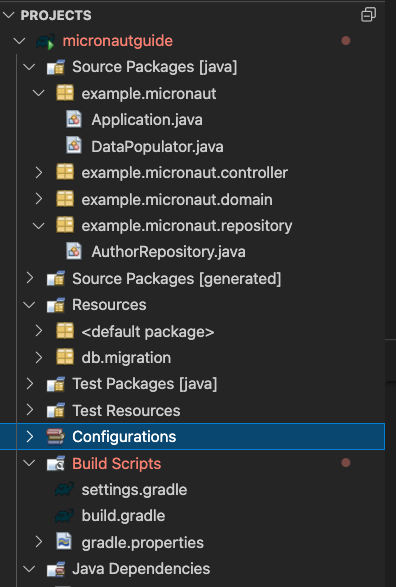
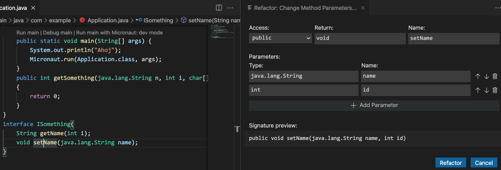
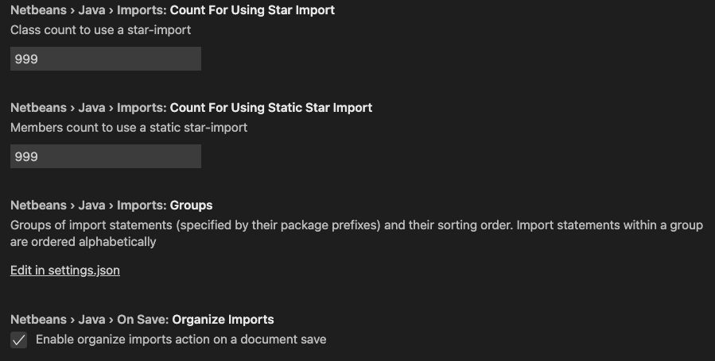
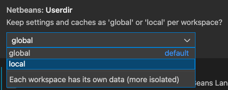
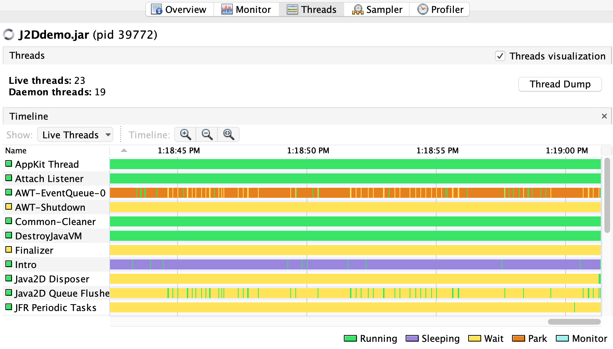

## 22.0.0
(2021-01-18)

* [Platform Updates](#platform-updates)
* [Java and Compiler Updates](#java-and-compiler-updates)
* [Native Image](#native-image)
* [JavaScript](#javascript)
* [Ruby](#ruby)
* [Python](#python)
* [R](#r)
* [LLVM Runtime](#llvm-runtime)
* [WebAssembly](#webassembly)
* [Java on Truffle](#java-on-truffle)
* [Polyglot Embedding](#polyglot-embedding)
* [Truffle Language and Tool Implementations](#truffle-language-and-tool-implementations)
* [Tools](#tools)

### Platform Updates

* Dropped support for Java 8. As of this release and later, GraalVM Enterprise distributions will be based on JDK 11 and 17 only.
* Removed support for JDK versions 12, 13, 14, 15, and 16.

* The OpenJDK release that GraalVM Community Edition is built on was updated to:
  * **11.0.14** for Java 11-based GraalVM Community. See [OpenJDK 11.0.14 Updates](https://wiki.openjdk.java.net/display/JDKUpdates/JDK11u "OpenJDK 11.0.14 Updates")
  * **17.0.2** for Java 17-based GraalVM Community. See [OpenJDK 17 Updates](https://jdk.java.net/17/ "OpenJDK 17 Updates")

* The Oracle JDK release that GraalVM Enterprise Edition is built on was updated to:
  * **11.0.14** for Java 11-based GraalVM Enterprise. See [Java SE 11 release notes](https://www.oracle.com/java/technologies/javase/11-0-14-relnotes.html "Java SE 11 Release Notes")
  * **17.0.2** for Java 17 based GraalVM Enterprise. See [Java SE 17 release notes](https://www.oracle.com/java/technologies/javase/17-relnotes.html "Java SE 17 Release Notes")
  

### Java and Compiler Updates

* Added a new loop rotation optimization that converts more non-counted loops to counted loops (only available in GraalVM Enterprise). A counted loop is an abstraction the compiler uses to ensure a loop's iteration limit is a bound integer. When the loop is counted, it becomes amenable for partial unrolling, vectorization, and other optimizations to improve performance. For example, the following code for `LinkedList.toArray()` in JDK 17:
  ```java
  public Object[] toArray() {
    Object[] result = new Object[size];
    int i = 0;
    for (Node<E> x = first; x != null; x = x.next)
      result[i++] = x.item;
    return result;
  }
  ```
  will be optimized by the compiler to:
  ```java
  public Object[] toArray() {
    Object[] result = new Object[size];
    int i = 0;
    Node<E> x = first;
    if (x == null) return result;             // Loop condition 1
    while (true) {
      if (i |>=| result.length) deoptimize(); // Loop condition 2
      result[i++] = x.item;
      x = x.next;
      if (x == null) break;                   // Loop condition 1
    }
    return result;
  }
  ```
  For a microbenchmark centered on `LinkedList.toArray()`, loop rotation brings a gain in performance of just over 10%.
  For workloads containing a lot of non-counted loops with a similar shape, performance improvements of up to 30% have been measured.
  Loop rotation is disabled by default in 22.0 and can be enabled with `-Dgraal.LoopRotation=true`.

* Improved the Graal compiler treatment of execution profiles. (Only available in GraalVM Enterprise.)
  Graal was designed as an aggressive JIT compiler that heavily relies on profiles (see [here](https://wiki.openjdk.java.net/display/HotSpot/TypeProfile) and [here](https://wiki.openjdk.java.net/display/HotSpot/MethodData)) collected by the underlying runtime (HotSpot VM or Native Image).
  The profiles are used by the compiler to determine which branches are important, how often loops are executed, and which types are used in polymorphic code.
  That is, the compiler relies on profiles to determine where to focus optimization effort.
  As such, the quality of the profiles is critical to optimizations such as inlining, duplication, and vectorization.
  The compiler now automatically switches to an "AOT" (ahead-of-time) mode where major optimizations can still do a reasonable job in the absence of profiles.
  This helps in the following situations:
    * Truffle languages that do not profile uncommon patterns that still can become hot.
    * Native Image without [PGO](../../docs/reference-manual/native-image/guides/optimize-native-executable-with-pgo.md).

  We observe performance improvements for GraalVM Enterprise of up to 25% for loop and type-check heavy benchmarks that lacked good profiles.
  This optimization is always enabled and cannot be disabled as it is at the core of the compiler.
  It is transparent to the user and should provide general better code in absence of precise branch and loop profiles.

* Added a new optimization to improve the performance in Native Image of a type switch (i.e., a series of cascading `instanceof` branches). For example:

    ```java
    void foo(Object o) {
      if (o instanceof A) {
        // ...
      } else if (o instanceof B) {
        // ...
      } else if (o instanceof C) {
        // ...
      }
    }
    ```
    With the new optimization, the null check and load of `o`'s class are factored out:


    ```
    void foo(Object o) {
      if (o != null) {
        Object nonNullO = o;
        Class oClass = nonNullO.getClass();
        if (A.class.isAssignableFrom(oClass)) {
          // ...
        } else if (B.class.isAssignableFrom(oClass) {
          // ...
        } else if (C.class.isAssignableFrom(oClass)) {
          // ...
        }
      }
    }
    ```
    This optimization only pays off if there are subclasses of `A`, `B`, and `C` that Native Image sees as allocated. Otherwise, the `instanceof` tests are reduced to `==` comparisons on the class of `o`.

A full list of compiler changes in GraalVM Community Edition can be found in the [compiler changelog](https://github.com/oracle/graal/blob/master/compiler/CHANGELOG.md#version-2200).

### Native Image

* Added updates to reduce image size: a more compressed encoding for stack frame metadata reduces image size for all images. In addition, an optimized implementation of `String.format()` makes localization classes unreachable for small images such as "Hello World" and reduces their size significantly. Note: The `String.format` optimization is available with GraalVM Enterprise only.
* GraalVM 22.0 will be the final release in which the `native-image` builder can be executed with JDK 8. There is no need to explicitly check for and allow JDK versions 12, 13, 14, 15, 16 because they are no longer supported. It is recommended to use Native Image with GraalVM JDK 11 or JDK 17.
* Introduced a new [user-friendly build output for `native-image`](../../docs/reference-manual/native-image/BuildOutput.md) with progress bars and more summary information about a native image build process. The previous output can be restored with `-H:-BuildOutputUseNewStyle`.
* Enabled a new garbage collection policy for the [Serial Garbage Collector](../../docs/reference-manual/native-image/MemoryManagement.md) (Serial GC) by default. This reduces the time spent in GC and/or the RSS size of the application up to 30%. The Serial GC algorithm is a good choice for small heaps.
* Improved support for the Java Platform Module System: the options `--add-reads` and `--add-modules` are now supported by `native-image`. Also, all module-related options such as `--add-reads`, `--add-exports`, and `--add-opens` are now applied before scanning the classpath/module-path. This ensures the modules are properly configured before class loading to prevent class loading errors. More information about modules is added to the image heap, which allows more module introspection at run time.
* Added support for reflective introspection of sealed classes on JDK 17: `Class.isSealed()` and `Class.getPermittedSubclasses()`.
* Removed support for JLine 2. Substitutions for JLine 2 were historically included in Native Image. Since JLine 2 is no longer maintained, the support was removed without replacement.
* Removed the option `-H:SubstitutionFiles=...` to register substitutions via a JSON file.
* Updated the C to Java interoperability: custom prolog, epilogue, and exception handling methods for `@CEntryPoint` entry points from C to Java must be annotated with `@Uninterruptible`. They were always treated as uninterruptible, but now they must be marked explicitly.
* Improved the [Native Image API](https://www.graalvm.org/truffle/javadoc/org/graalvm/nativeimage/package-summary.html): added `CEntryPoint#include` attribute which can be used to control if the entry point should be automatically added to a shared library. The Native Image API is now also supported on the Windows AARCH64 platform.

### JavaScript

* Enabled ECMAScript 2022 mode/features by default.
* Updated Node.js to version 14.18.1.
* Implemented several proposals: [Intl.DisplayNames v2](https://github.com/tc39/intl-displaynames-v2), [Intl Locale Info](https://github.com/tc39/proposal-intl-locale-info), [Intl.DateTimeFormat.prototype.formatRange](https://github.com/tc39/proposal-intl-DateTimeFormat-formatRange), [Extend TimeZoneName Option](https://github.com/tc39/proposal-intl-extend-timezonename), [Intl Enumeration API](https://github.com/tc39/proposal-intl-enumeration).
* Added a new option `js.esm-bare-specifier-relative-lookup`, defaulting to `false`, to customize how bare specifiers for ES Modules are resolved. When disabled, bare specifiers are resolved with an absolute path lookup. When enabled, bare specifiers are resolved relative to the importing module's path.

A full list of changes is available in the [changelog](https://github.com/oracle/graaljs/blob/master/CHANGELOG.md#version-2200).

### Ruby

* Updated to Ruby 3.0.2, see [#2453](https://github.com/oracle/truffleruby/issues/2453). Most of Ruby 3 changes are implemented in this release, with the exception of Ractor, parser changes, and keyword arguments changes.
* TruffleRuby now requires Java 11 or later and no longer supports Java 8.
* Updated Regexp objects to be interned in a similar way to symbols. As a consequence, all Regexp instances are frozen.
* Added various optimizations to make the interpreter faster (before the code is JIT-compiled).

A full list of changes is available in the [changelog](https://github.com/oracle/truffleruby/blob/master/CHANGELOG.md#2200).

### Python

* Added support for [`pyexpat` module](https://docs.python.org/3/library/pyexpat.html), which is a Python module for fast non-validating XML parsing, also known as `expat`.
* Implemented the `_csv accelerator` module to read and write tabular data in CSV format.
* Improved compatibility with PyPI packages such as `wheel`, `click`, and `ujson`.

The project [changelog](https://github.com/oracle/graalpython/blob/master/CHANGELOG.md#version-2200) is available on GitHub.

### R

* Improved the internal infrastructure, compatibility with the Truffle framework, and popular R packages.
* Adopted the new [NodeLibrary](https://www.graalvm.org/truffle/javadoc/com/oracle/truffle/api/interop/NodeLibrary.html), as a replacement for the old API that was removed in this release. It provides access to guest language information associated with a particular Node location. This helps GraalVM tool developers to better support the R language.

The project [changelog](https://github.com/oracle/fastr/blob/master/CHANGELOG.md#2200) is available on GitHub.

### LLVM Runtime

* Switched to the new [Truffle Frame API](https://www.graalvm.org/truffle/javadoc/com/oracle/truffle/api/frame/Frame.html).
* Optimized the loop count to report profiles also in first-tier compiled code. This improves the warmup by transitioning from first-tier to second-tier compilation sooner for loop-heavy methods.
* Added a fix to properly reuse library dependencies if some library with the same "soname" is already loaded. This allows users to depend on libraries that can not be found automatically on the library search path by manually loading them first.

The project [changelog](https://github.com/oracle/graal/blob/master/sulong/CHANGELOG.md#version-2200) is available on GitHub.

### WebAssembly

* Improved the compatibility of GraalVM's WebAssembly runtime with the Truffle framework by adopting the new [Frame API](https://www.graalvm.org/truffle/javadoc/com/oracle/truffle/api/frame/Frame.html).
* Implemented the [Sign-Extension-Ops proposal](https://github.com/WebAssembly/sign-extension-ops). It is available by using the experimental option `--wasm.SignExtensionOps`.

### Java on Truffle

* Improved compatibility with the Truffle framework by adopting the new [Frame API](https://www.graalvm.org/truffle/javadoc/com/oracle/truffle/api/frame/Frame.html).
* Added support for more class changes during a class redefinition, namely changes to fields and class access modifiers. Enable with the `--java.ArbitraryChangesSupport=true` flag.

### Polyglot Embedding

* Introduced the first version of Polyglot Isolates. You can spawn a native image isolate for each `Engine` or `Context` by calling `Context.Builder.option("engine.SpawnIsolate", "true")`. This enables heap isolation between the host and guest applications. Using isolates improves security, startup and warmup time of Truffle languages, and provides strong memory isolation for guest applications. In this mode, calls between host and guest are more costly as they need to cross a native boundary. It is recommended to use the `HostAccess.SCOPED` policy with this mode to avoid strong cyclic references between host and guest. This mode is experimental in this release and only supported for JavaScript. (Only available in GraalVM Enterprise.)

The project [changelog](https://github.com/oracle/graal/blob/master/sdk/CHANGELOG.md#version-2200) is available on GitHub.

### Truffle Language and Tool Implementations

* Added new APIs to `com.oracle.truffle.api.frame.Frame` and `com.oracle.truffle.api.frame.FrameDescriptor`:
  * Added a new "namespace" of index-based slots in `Frame` that is defined during construction of the frame descriptor and cannot be changed afterward.
  * Added a second new "namespace" of slots (called auxiliary slots) in `Frame` that can be added to the frame descriptor dynamically (and which only supports "object" slots).
  * In addition to `get...`/`set...` methods, the new API also supports `copy` and `swap` of frame slots.
  * `FrameSlotTypeException` is now an unchecked exception, which simplifies many APIs and removes the need for the `FrameUtil` class.
* Introduced sharing layers. A sharing layer is a set of language instances that share code within one or more polyglot contexts. In previous releases language instances were shared individually whenever a new language context was created. Instead, language instances are now reused for a new context if and only if the entire layer can be shared. A layer can be shared if all of its initialized languages support the same context policy and their options are compatible. Note some changes in observable language behavior:
  * For any executed Truffle node it can now be assumed that the current language instance will remain constant.
  * `TruffleLanguage.initializeMultipleContexts()` is now guaranteed to be called before all created contexts of the same language instance.
  * Language initialization will now fail if a new language context is initialized and the language is incompatible to the sharing layer of the current context.
  * A complete list of behavioral changes can be found in the [changelog](https://github.com/oracle/graal/blob/master/truffle/CHANGELOG.md?plain=1#L19). Read more on code sharing in the [javadoc](https://www.graalvm.org/truffle/javadoc/com/oracle/truffle/api/TruffleLanguage.ContextPolicy.html).
* Introduced a [Truffle Exit API](https://www.graalvm.org/truffle/javadoc/com/oracle/truffle/api/TruffleLanguage.ExitMode.html) to support exit across multiple languages. It provides a unified way for languages to trigger the exit. When triggered, all initialized guest languages are first notified using `TruffleLanguage.exitContext(C,ExitMode,int)`, then all context threads are stopped, and finally, the context is closed. See the [documentation](../../truffle/docs/Exit.md) for more details.
* Imposed a new requirement in `TruffleLanguage.finalizeContext(Object)` for leaving all remaining unclosed inner contexts created by the language on all threads where the contexts are still active. No active inner context is allowed after `TruffleLanguage.finalizeContext(Object)` returns. Not complying with this requirement will result in an internal error. Note that inactive inner contexts are still closed implicitly by the parent context.
* Improved the output format for `engine.TraceCompilation` and `engine.TraceCompilationDetails`. See the [documentation](../../truffle/docs/Optimizing.md) for details.
* Added the `--engine.TraceCodeSharing` option that allows logging debug information on code sharing.
* Added the `--engine.ForceCodeSharing` and `--engine.DisableCodeSharing` options to force enable and force disable code sharing. These options are useful for testing to enable or disable sharing across all contexts of a process.

A full list of updates can be found in the [changelog](https://github.com/oracle/graal/blob/master/truffle/CHANGELOG.md#version-2200).

### Tools

### VS Code Extensions

* Added the Project Explorer which provides an overview of logical project structure, groups sources together and greatly simplifies Java package structure exploration. Project Explorer is an addition to the classical workspace explorer. Use it to build, test, execute and operate your Maven and Gradle Java projects:

  

* Introduced a number of refactorings and improvements to GraalVM extensions for VS Code, which include:

  * Provided a graphical UI for the change method signature refactoring:

    

  * Ability to organize Imports for the source file accompanied with several other settings:

    

  * Ability to generate `equals()` and `hashCode()` methods

* Added the Outline View that provides all details about the opened Java file
* Added the ability to run separate NetBeans Language Server for each VS Code instance using its own classpath and JDK. Use a new option `userdir = global | local`:

  

* Added the ability to manage GraalVM installation(s) with SDKMan
* Improved the Groovy language support by performance and reliability improvements, and ability to run a standalone Groovy script file (without Spock tests)
* Updated the Micronaut Gradle plugin to use the official GraalVM Native Image build plugin. As a consequence, the **Micronaut: Build Native Image...** action calles the `nativeCompile` job instead of `nativeImage`.

### VisualVM

* Added exact thread state monitoring using JFR events. See [#363](https://github.com/oracle/visualvm/issues/363).

  

* Added preliminary support for JDK 18.
