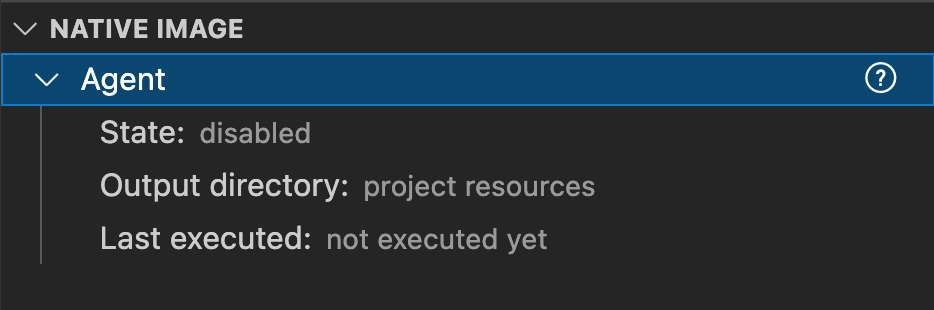
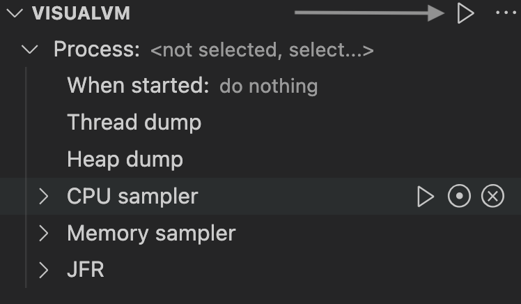

## 22.1.0
(2022-04-26)

* [Platform Updates](#platform-updates)
* [Java and Compiler Updates](#java-and-compiler-updates)
* [Native Image](#native-image)
* [JavaScript](#javascript)
* [Ruby](#ruby)
* [Python](#python)
* [R](#r)
* [LLVM Runtime](#llvm-runtime)
* [Java on Truffle](#java-on-truffle)
* [Polyglot Embedding](#polyglot-embedding)
* [Truffle Language and Tool Implementations](#truffle-language-and-tool-implementations)
* [Tools](#tools)

### Platform Updates

* Added support for Apple Silicon, an ARM-based system on a chip by Apple Inc. You can [download the GraalVM Community](https://github.com/graalvm/graalvm-ce-builds/releases/tag/vm-22.1.0) distribution for this platform from GitHub. Look for `darwin-aarch64`. Currently, you can use the [JVM with `libgraal`](../../docs/reference-manual/java/compiler.md#compiler-operating-modes), Native Image, the JavaScript runtime, and Java on Truffle features with this distribution. The support is experimental.

* Updated the OpenJDK release on which GraalVM Community Edition is built to:
  * **11.0.15** for Java 11-based GraalVM Community. See [OpenJDK 11.0.15 Updates](https://wiki.openjdk.java.net/display/JDKUpdates/JDK11u "OpenJDK 11.0.15 Updates")
  * **17.0.3** for Java 17-based GraalVM Community. See [OpenJDK 17 Updates](https://jdk.java.net/17/ "OpenJDK 17 Updates")

### Java and Compiler Updates

* A counted loop is an abstraction the compiler uses to ensure a loop's iteration limit is a bound integer.
Such loops are subject to major optimizations such as vectorization and partial unrolling.
The Truffle API provides the ability to profile and speculate on a loop counter value having a max value that can be treated as constant by the compiler. The Graal compiler now respects this speculation and will unroll such loops if the max value is small enough. For example, this Ruby loop will now be unrolled:
    ```java
    [1, 2].each { |e| print e }
    ```
* Implemented all the intrinsics annotated by `@IntrinsicCandidate` as of JDK 17.
* Removed the `DuplicateIrreducibleLoops` option. To disable irreducible loop handling, set `-Dgraal.MaxDuplicationFactor` to a value less than or equal to 1. For ahead-of-time (AOT) compilations, the effort spent to handle irreducible loops is boosted to let Native Image support more programs with irreducible loops. In particular, this mitigates [this issue](https://github.com/oracle/graal/issues/4265).

### Native Image

* The option `--allow-incomplete-classpath` is now enabled by default and deprecated as it is no longer needed. This means that, by default, linking errors are now thrown at executable run time instead of at build time. The new option `--link-at-build-time` enables linking at build time for a specified list of packages and classes. You can provide as many `--link-at-build-time` options with specific arguments on command line as you want, for example, `native-image --link-at-build-time=foo.bar,foobar.core.MyClass --link-at-build-time=my.other.RandomClass ...`.  See [#4305](https://github.com/oracle/graal/pull/4305).
* Added a new "quick build" mode to reduce the time taken to generate a native executable during development. Enable it using the existing option to select the optimization level: `-Ob`, where `b` means _optimize for build time_. Note that this mode can have a negative impact on peak performance and the size of the resulting executable, thus recommended for development purposes only.
* Added a new experimental mode to generate conditional configuration using the [Tracing agent](../../docs/reference-manual/native-image/AutomaticMetadataCollection.md). The agent can now generate conditional reflection configuration using a heuristic that operates on the call graph, that is, those reflection elements that are only registered when a predicate class is reachable. Two modes are supported:
    - By passing `experimental-conditional-config-filter-file=<path>` to the agent. In this mode, the agent directly generates the configuration. The filter tells the agent which code belongs to the user’s application. Conditions are only generated on the classes belonging to the user’s application.
    - By passing `experimental-conditional-config-part` to the agent and using `native-image-configure generate-conditional --user-code-filter=<path> --input-dir=<agent-ouput> --output-dir=<config-output>` to generate the configuration. Check the [Native Image documentation](../../docs/reference-manual/native-image/ExperimentalAgentOptions.md) for more information.
* Introduced code size improvements that help reduce the size of native executables. Performance improvements and memory footprint reductions for the `native-image` generator lead to faster build times (independent of the new "quick build" mode). The following table shows the image size and time taken to build an executable for [Spring petclinic-jdbc](https://github.com/spring-petclinic/spring-petclinic-data-jdbc), a well-known large application. The numbers are measured on a developer machine with Linux, AMD64, JDK 11, GraalVM Enterprise, [spring-native 0.10.3](https://docs.spring.io/spring-native/docs/current/reference/htmlsingle/).

    | GraalVM Version  | Build Time      | Executable Size | Build Time with -Ob |
    |------------------|-----------------|-----------------|---------------------|
    | GraalVM 21.1     | 2 min 50 sec    | 138 MB          |                     |
    | GraalVM 21.2     | 2 min 43 sec    | 133 MB          |                     |
    | GraalVM 21.3     | 2 min 13 sec    | 121 MB          |                     |
    | GraalVM 22.0     | 2 min 20 sec    | 119 MB          |                     |
    | **GraalVM 22.1** | **2 min 5 sec** | **103 MB**      | **1 min 17 sec**    |

* Added support for Apple Silicon, an ARM-based system on a chip. One of the missing features was, for example, support for Truffle just-in-time compilation.
* Improved the ahead-of-time compilation of Record classes. For example, annotations of Record classes can now be accessed at executable runtime.
* Added support for the following JFR events: `SafepointBegin`, `SafepointEnd`, `GarbageCollection`, `GCPhasePause`, and `GCPhasePauseLevel` (all contributed by Red Hat). All GC-related JFR events are currently limited to the [Serial GC](../../docs/reference-manual/native-image/MemoryManagement.md).
* JFR can now be used to profile the `native-image` tool itself, for example, by adding `-J-XX:StartFlightRecording=dumponexit=true` on the command line to `native-image`.
* Improved handling of `static synchronized` methods: the lock is no longer stored in the secondary monitor map, but instead in the mutable `DynamicHubCompanion` object. With this change, the synchronization of `static` methods is as fast as the synchronization of instance methods.
* Added support for `AccessControlContext` that helps to control the context that can be modified using privileged operations.
* References handling is now performed in a separate thread by default. It helps prevent occasional deadlocks when handling references and running garbage collection in the same thread.
* Added the possibility to include helper methods in the native executable that can be invoked from `gdb` and therefore help debugging native executables. Provide the option `-H:+IncludeDebugHelperMethods` to `native-image` to enable this feature.
* Deprecated the `JDK8OrEarlier` and `JDK11OrLater` classes because JDK 8 is no longer supported. They will be removed in a future release.
* Every annotated element (classes, methods, fields, etc.) will be included in the image regardless of reachability. It may require some configuration changes, especially for dynamically-generated proxies. For example, using the following code:
    ```java
    @AccessedAnnotation
    @NonAccessedAnnotation
    class Example {
    boolean func(Object obj) {
        Proxy.getProxyClass(classLoader, Example.class.getDeclaredAnnotations());
        obj.isAnnotationPresent(AccessedAnnotation.class);
        }
    }
    ```
    Previously, you would only specify the `[AccessedAnnotation]` configuration. Now the proxy configuration would look like `[AccessedAnnotation], [NonAccessedAnnotation]`.

* Prevented class path entries in `META-INF/MANIFEST.MF` being processed in the wrong order. See [#4374](https://github.com/oracle/graal/issues/4374)
* Now using `-H:CompilerBackend=llvm` also works if the `native-image` builder runs on the module-path (when building with the `--module-path` flag). See [#4336](https://github.com/oracle/graal/issues/4336).
* Improved building native executables inside a container if a resource path contains a forward slash, `/`, as a working directory. See [#4002](https://github.com/oracle/graal/issues/4002).

### JavaScript

* Updated Node.js to version 16.14.2.
* Implemented a number of proposals:
    * The [Intl.NumberFormat v3](https://github.com/tc39/proposal-intl-numberformat-v3) proposal.
    * The [Array Grouping](https://github.com/tc39/proposal-array-grouping) proposal. It is available in the ECMAScript staging mode using the `--js.ecmascript-version=staging` option.
    * The [Temporal](https://github.com/tc39/proposal-temporal) proposal. It is available behind the experimental option `--js.temporal`.
    * The [Array Find from Last](https://github.com/tc39/proposal-array-find-from-last) proposal. It is available in ECMAScript staging mode using the `--js.ecmascript-version=staging` option.
* Added a new option `--js.string-lazy-substrings`, defaulting to `true`, to toggle the copying behavior of String slices. When enabled, String slices internally create String views instead of copying the given String region, which increases performance but may also increase memory utilization.

A full list of changes is in the [changelog](https://github.com/oracle/graaljs/blob/master/CHANGELOG.md#version-2210).

### Ruby

* Implemented full Ruby 3 keyword arguments semantics (see [#2453](https://github.com/oracle/truffleruby/issues/2453)).
* Foreign exceptions are now fully integrated, have most methods of `Exception`, and can be rescued with `rescue Polyglot::ForeignException` or `rescue foreign_meta_object` (see [#2544](https://github.com/oracle/truffleruby/issues/2544)).
* Foreign exceptions are no longer translated to `RuntimeError` but instead remain as foreign exceptions.
* Added various fixes for the digest default gem, RubyGems, and Bundler ([#2577](https://github.com/oracle/truffleruby/issues/2577), [#2605](https://github.com/oracle/truffleruby/issues/2605), [#2586](https://github.com/oracle/truffleruby/issues/2586)).
* Fixed `Module#const_get` to raise a `NameError` when nested modules do not exist, needed for Rails 7 scaffolding.
* Removed extra array allocations for method calls in the interpreter to improve warmup performance.
* Reduced memory footprint for C extensions (separate Init_ allocations from the rest, fewer handles, and others).
* Optimized `Dir[]`, `String#<=>`, `Regexp#match?` and `File.read` (see [#2536](https://github.com/oracle/truffleruby/issues/2536)).

A full list of changes is available in the [changelog](https://github.com/oracle/truffleruby/blob/master/CHANGELOG.md#2210).

### Python

* Added support for module freezing which makes the Python REPL start 30% faster and with 40% less memory usage.
* Added support for more private key formats (PKCS#1, password protected) in the `ssl` module.
* Improved compatibility with the following PyPI packages: `lxml`, `pytz`, `Pillow`, `urllib3`, `setuptools`, `pytest`, `twine`, `jinja2`, and `six`.

A full list of changes is in the [changelog](https://github.com/oracle/graalpython/blob/master/CHANGELOG.md#version-2210) on GitHub.

### R

* [JavaGD](https://cran.r-project.org/web/packages/JavaGD/index.html) is now the default graphical subsystem. The `--R.UseInternalGridGraphics` option is deprecated. Most functions from `graphics` `grid`, and `grDevices` base packages are supported. Supported devices are SVG, PNG, JPEG, BMP, AWT. Display lists are fully implemented. See the [documentation](https://github.com/oracle/fastr/blob/release/graal-vm/22.1/documentation/dev/graphics.md) for more information.
* GraalVM's R runtime now uses system `zlib` instead of its own copy of this library. This makes `zlib` a requirement for GraalVM's R runtime, however, most Linux distributions and all supported macOS versions have `zlib` preinstalled. One conceivable situation, where this may not be the case, could be some optimized stripped-down Docker images.

The project [changelog](https://github.com/oracle/fastr/blob/master/CHANGELOG.md#2210) is available on GitHub.

### LLVM Runtime

* Added support for C/C++ thread-local storage.
* Added support for new interop APIs:
    * `Date`, `Time`, `TimeZone` and `Instant` ([see `graalvm/llvm/polyglot-time.h`](https://github.com/oracle/graal/blob/release/graal-vm/22.1/sulong/projects/com.oracle.truffle.llvm.libraries.graalvm.llvm/include/graalvm/llvm/polyglot-time.h))
    * `Buffers` (see [graalvm/llvm/polyglot-buffer.h](https://github.com/oracle/graal/blob/release/graal-vm/22.1/sulong/projects/com.oracle.truffle.llvm.libraries.graalvm.llvm/include/graalvm/llvm/polyglot-buffer.h))
* Replaced custom logging options in the `--llvm.*` namespace (e.g., `--llvm.traceIR`) with Truffle Logger options (`--log.llvm.*`, for example, `--log.llvm.TraceIR.level=FINER`).

See a full list of changes and option replacements in the project [changelog](https://github.com/oracle/graal/blob/master/sulong/CHANGELOG.md#version-2210) on GitHub.

### Java on Truffle

* Enabled explicit reference processing in single-threaded mode. This means the single-threaded mode is usable in many more situations to prevent leaking resources. It is available as a command called `<ProcessReferences>`, which can be run with `context.eval("java", "<ProcessReferences>")`.
* Introduced new hotswap capabilities:
    * Added support for changing the super class and implemented interfaces.
    * Added support for 'Move Field in Hierarchy' refactoring where the state is preserved.
    * Turned on by default changing fields and class access modifiers.
* Enabled responding to [Truffle safepoints](../../truffle/docs/Safepoints.md) more promptly in many situations (including when using monitors).
* Adopted the [AbstractTruffleException API](https://www.graalvm.org/truffle/javadoc/com/oracle/truffle/api/exception/AbstractTruffleException.html) to improve exception handling thrown during the execution of a guest language program.
* Added a new implementation for reading `jimages` (`libs/modules`), which is enabled by default. This improves context startup time when using the LLVM backend. Use `--java.JImage=native` to revert to the old implementation.
* The Java on Truffle LLVM Java libraries are now provided for macOS (previously they were available for Linux distributions only) and can be installed using GraalVM Updater: `gu install espresso-llvm`.

### Polyglot Embedding

* Changed the default [Object target type mapping (Value.as(Object.class))](https://www.graalvm.org/sdk/javadoc/org/graalvm/polyglot/Value.html#as-java.lang.Class-) for values that have both array elements and members from `Map` to `List`. Note that this is an incompatible change. Embedders relying on the dynamic type `Map` after an `Object` target type coercion will have to migrate their code. The previous behavior can be restored using a custom [target type mapping](https://www.graalvm.org/sdk/javadoc/org/graalvm/polyglot/HostAccess.Builder.html#targetTypeMapping-java.lang.Class-java.lang.Class-java.util.function.Predicate-java.util.function.Function-), for example:
    ```java
    HostAccess access = HostAccess.newBuilder(HostAccess.EXPLICIT)
            .targetTypeMapping(Value.class, Object.class, v -> v.hasMembers() && v.hasArrayElements(), v -> v.as(Map.class))
            .build();
    try (Context c = Context.newBuilder().hostAccess(access).build()) {
        // run application
    }
    ```

The [changelog](https://github.com/oracle/graal/blob/master/sdk/CHANGELOG.md#version-2210) is available on GitHub.

### Truffle Language and Tool Implementations

* Added an API for Truffle languages, namely [`Language#getWebsite()`](https://www.graalvm.org/truffle/javadoc/com/oracle/truffle/api/TruffleLanguage.Registration.html#website--), and [`Instrument#getWebsite()`](https://www.graalvm.org/truffle/javadoc/com/oracle/truffle/api/instrumentation/TruffleInstrument.Registration.html#website--) for instruments to provide information for a website. Developers can specify a URL for a website with further information about their language/tool.
* Added the [TruffleStrings](https://github.com/oracle/graal/blob/master/truffle/docs/TruffleStrings.md) implementation, a primitive String type that can be shared between Truffle languages (languages implemented with the Truffle framework). Check [Truffle Strings guide](../../truffle/docs/TruffleStrings.md) for more information.
* Added a `@GeneratePackagePrivate` annotation to change the visibility of generated nodes to _package-private_ even if the template node is public.
* Added [`TruffleLanguage.Env#createHostAdapter`](https://www.graalvm.org/truffle/javadoc/com/oracle/truffle/api/TruffleLanguage.Env.html#createHostAdapter-java.lang.Object:A-) accepting host symbols and host classes as the types to extend, replacing and deprecating the `java.lang.Class`-based version.
* Added the `usageSyntax` property to `Option` enabling developers to specify the syntax that their option expects. See the [Javadoc](https://www.graalvm.org/truffle/javadoc/com/oracle/truffle/api/Option.html#usageSyntax--) for more information.
* Removed the deprecated `TruffleException` (deprecated since GraalVM 20.3.0). The `AbstractTruffleException` no longer implements `TruffleException`. The `AbstractTruffleException` methods inherited from the `TruffleException` have been removed. As part of this removal, the recommendation for languages on [how to handle exceptions](https://www.graalvm.org/truffle/javadoc/com/oracle/truffle/api/interop/InteropLibrary.html#isException-java.lang.Object-) has been updated.
* Added methods to [`TruffleContext.Builder`](https://www.graalvm.org/truffle/javadoc/com/oracle/truffle/api/TruffleContext.Builder.html) that allow throwing custom guest exceptions when the newly built context is canceled, hard-exited, or closed, and the corresponding exception is about to reach the outer context. In case the customization is not used and the new context is canceled, hard-exited, or closed, Truffle newly throws an internal error.
* Deprecated `TruffleRuntime.getCurrentFrame()` and `TruffleRuntime.getCallerFrame()`. They were encouraging unsafe use of the `FrameInstance`  class.

Other deprecations and updates in the release are listed in the [project changelog](https://github.com/oracle/graal/blob/master/truffle/CHANGELOG.md#version-2210).

### Tools

### GraalVM for Java VS Code Extension

* Updated the workflow to download and install GraalVM Enterprise Edition and its accompanying components using the GraalVM built-in installation wizard in VS Code. As before, to install a GraalVM Enterprise core or additional components, a user has to provide a valid email address and accept the license agreement. The installation wizard will now use a **download token** that is bound to the user's email address and defines the set of accepted licenses. Email verification and license acceptance take place via the user's email client.

* Added the **NATIVE IMAGE** pane to automate the process of tracking and registering dynamic feature calls, making it even easier to build a native executable in VS Code. The pane becomes available when you install GraalVM and with Native Image:

     

* Improved the VS Code integration in VisualVM with the extension. Now you do not have to create a special launch configuration to open VisualVM and start monitoring a Java process. Click the play button in the **VISUALVM** pane:

     

* Improved Groovy support including the ability to **Run and Debug** Groovy.

### GraalVM Updater

* Enhanced the workflow to install components to GraalVM Enterprise Edition from the command line using GraalVM Updater, `gu`. GraalVM Updater will create and use a **download token**, which is bound to the user's email address and defines the set of accepted licenses. As before, to install a component, the user has to provide a valid email address and accept the license agreement, but now the email verification and the license acceptance will happen in the user's email client. For more information, see the [documentation](../../docs/reference-manual/graalvm-updater.md).
